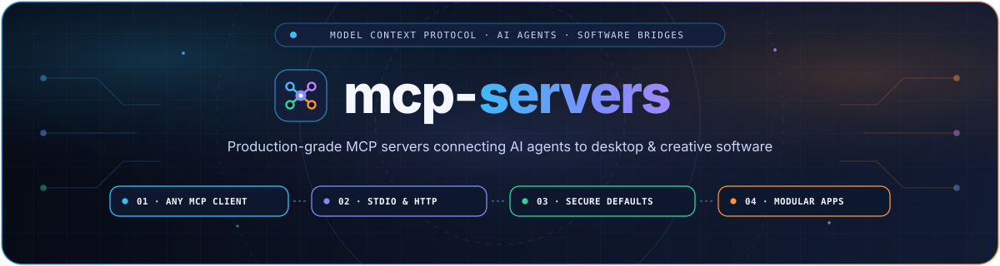
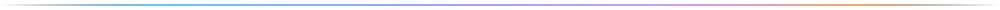
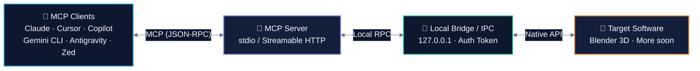

<div align="center">



<br />

[](https://modelcontextprotocol.io/)
[](#-available-servers)
[](#-architecture)
[](./blender/README.md)
[](./LICENSE)

<p align="center">
  <strong>A curated collection of standalone Model Context Protocol (MCP) servers for desktop and creative software.</strong><br />
  <em>Give AI agents from Claude, Cursor, VS Code Copilot, Gemini CLI, Antigravity, Windsurf, Codex, or Zed direct, semantic control over real tools.</em>
</p>

<p align="center">
  <a href="#-available-servers">Servers</a> ·
  <a href="#-architecture">Architecture</a> ·
  <a href="#-quick-start">Quick Start</a> ·
  <a href="#-repository-structure">Structure</a> ·
  <a href="#-license">License</a>
</p>

</div>



## ✨ Overview

**`mcp-servers`** is a monorepo hosting independent, production-grade **Model Context Protocol (MCP)** servers so AI agents can operate third-party software reliably — beyond fragile UI clicking or unrestricted arbitrary scripts.

| Principle | How it is applied across servers |
| :--- | :--- |
| 🧩 **Standalone & Modular** | Each server lives in its own top-level folder with independent dependencies, tests, CI workflow, and dedicated documentation. |
| 🎯 **Semantic Over Raw Scripting** | High-level typed tools, structured diffs, resources, and visual feedback loops instead of brittle ad-hoc code injection. |
| 🔒 **Secure by Default** | Localhost-only bridges, session authentication, directory allowlists, audit trails, and explicit opt-in gates for risky actions. |


## 🔌 Available Servers

Each server maintains its own `README.md`, installation steps, client configuration snippets, and tool reference.

| Server | Target Software | Highlights | Runtime & Transport | License | Status |
| :--- | :--- | :--- | :--- | :--- | :---: |
| [**`blender/`**](./blender/README.md) | **Blender 3D** (`3.6 LTS → 5.3+`) | 128 semantic tools across 19 toolsets, declarative Nodes DSL, visual viewport feedback, async jobs, dynamic toolsets, multi-instance control, Poly Haven / ambientCG / Sketchfab / AI 3D integrations & plugin system · [Clients](./blender/docs/CLIENTS.md) · [Tools](./blender/docs/TOOLS_REFERENCE.md) · [Plugins](./blender/docs/PLUGINS.md) | Python (`uv`) · `stdio`, Streamable HTTP, Docker | `MIT` + `GPL-3.0-or-later` *(add-on)* | ✅ `v1.0` |

> [!NOTE]
> More MCP servers for additional desktop, creative, and engineering applications are planned and will be added as standalone directories in this repository.


## 🧠 Architecture

Every server follows a clean process separation between the **MCP Server** (talking standard MCP to any agent client) and a lightweight **local bridge / adapter** inside or alongside the target software:




## 🚀 Quick Start

Clone the repository and navigate to the server you want to use:

```bash
git clone https://github.com/antonyguedes/mcp-servers.git
cd mcp-servers
```

Then follow the setup guide inside the target server's directory:

- **Blender 3D:** see [`blender/README.md`](./blender/README.md) and [`blender/docs/CLIENTS.md`](./blender/docs/CLIENTS.md)


## 📁 Repository Structure

```text
mcp-servers/
├── .github/workflows/       # Per-server GitHub Actions CI workflows
├── docs/assets/             # Shared visual assets (banner & dividers)
├── blender/                 # blender-mcp v1.0 (MCP server + protocol + Blender add-on)
│   ├── README.md            # Full documentation, quick start & env vars
│   ├── docs/                # Client configs, auto-generated tool reference & plugin guide
│   ├── packages/            # server (MIT), protocol (MIT), addon (GPL-3.0-or-later)
│   ├── docker/              # Headless Blender + Streamable HTTP container
│   └── tests/               # Unit, security audit, E2E integration, evals & benchmarks
├── LICENSE                  # Root MIT License
└── README.md                # You are here
```


## 📄 License

This repository is distributed under the [MIT License](./LICENSE). © 2026 Antony Guedes.

Individual sub-components that integrate directly with copyleft software APIs carry their own license inside their respective folder (for example, [`blender/packages/addon/`](./blender/packages/addon/LICENSE) is licensed under `GPL-3.0-or-later` — see [`blender/LICENSING.md`](./blender/LICENSING.md) for details).


<div align="center">
  <sub>Built for reliable, secure, agent-native workflows across desktop and creative software.</sub>
</div>
